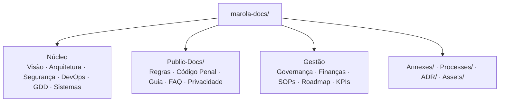

<div align="center">


# Marola RP — Documentação

### Documentação oficial do servidor Marola RP · Official documentation, PT/EN

Visão, arquitetura, regras, código penal, processos e governança de um servidor de roleplay brasileiro
no FiveM — tudo em português e inglês.

[](https://marolaroleplay.com.br)
[](https://discord.gg/mHrjCvMGBc)
[](LICENSE.md)

[](#documentos)
[](marola-docs/ADR/002-vrpex-framework.md)
[](marola-docs/ADR)
[](package.json)
[](CHANGELOG.md)

</div>

---

## Índice

- [Sobre](#sobre)
- [Para jogadores](#para-jogadores)
- [Documentos](#documentos)
- [Como a documentação é organizada](#como-a-documentação-é-organizada)
- [Verificações](#verificações)
- [Situação atual](#situação-atual)

---

## Sobre

Este repositório reúne **a documentação oficial do Marola RP**: o que o servidor quer ser, como ele funciona por
dentro e quais regras valem dentro e fora do jogo. Cada documento existe em português (`.pt.md`) e inglês (`.en.md`).

Feito para:

- **jogadores**, que precisam das regras, do código penal e do guia;
- **staff**, que segue SOPs, processos de deploy e a matriz RACI;
- **colaboradores**, que querem entender a arquitetura antes de contribuir.

> *English:* this repository holds Marola RP's official documentation. Every document has a Portuguese and an
> English version — see the [table below](#documentos).

---

## Para jogadores

1. Entre no [Discord](https://discord.gg/mHrjCvMGBc).
2. Leia as [Regras](marola-docs/Public-Docs/Rules.pt.md) e o [Código Penal](marola-docs/Public-Docs/PenalCode.pt.md).
3. Peça a whitelist seguindo as instruções do bot no Discord.
4. Leia o [Guia do jogador](marola-docs/Public-Docs/Guide.pt.md) e o [FAQ](marola-docs/Public-Docs/FAQ.pt.md).
5. Precisa de ajuda? Abra um ticket no Discord.

---

## Documentos

| Documento | PT | EN | Assunto |
|---|---|---|---|
| **Visão** | [PT](marola-docs/Vision.pt.md) | [EN](marola-docs/Vision.en.md) | Objetivos e identidade do projeto |
| **Arquitetura** | [PT](marola-docs/Architecture.pt.md) | [EN](marola-docs/Architecture.en.md) | Arquitetura técnica do servidor |
| **Segurança** | [PT](marola-docs/Security.pt.md) | [EN](marola-docs/Security.en.md) | Anticheat, auditoria e resposta a incidentes |
| **DevOps** | [PT](marola-docs/DevOps.pt.md) | [EN](marola-docs/DevOps.en.md) | Ambientes, deploy e operação |
| **GDD** | [PT](marola-docs/GDD.pt.md) | [EN](marola-docs/GDD.en.md) | Game design |
| **Sistemas** | [PT](marola-docs/Systems.pt.md) | [EN](marola-docs/Systems.en.md) | Sistemas de jogo |
| **Governança** | [PT](marola-docs/Governance.pt.md) | [EN](marola-docs/Governance.en.md) | Papéis e decisões |
| **Finanças** | [PT](marola-docs/Finance.pt.md) | [EN](marola-docs/Finance.en.md) | Custos e transparência |
| **Regras** | [PT](marola-docs/Public-Docs/Rules.pt.md) | [EN](marola-docs/Public-Docs/Rules.en.md) | Regras do servidor |
| **Código Penal** | [PT](marola-docs/Public-Docs/PenalCode.pt.md) | [EN](marola-docs/Public-Docs/PenalCode.en.md) | Crimes e penas dentro do RP |
| **Guia** | [PT](marola-docs/Public-Docs/Guide.pt.md) | [EN](marola-docs/Public-Docs/Guide.en.md) | Primeiros passos |
| **FAQ** | [PT](marola-docs/Public-Docs/FAQ.pt.md) | [EN](marola-docs/Public-Docs/FAQ.en.md) | Perguntas frequentes |
| **Privacidade** | [PT](marola-docs/Public-Docs/PrivacyPolicy.pt.md) | [EN](marola-docs/Public-Docs/PrivacyPolicy.en.md) | Política de privacidade |
| **Proteção de dados** | [PT](marola-docs/Data-Privacy.pt.md) | [EN](marola-docs/Data-Privacy.en.md) | Tratamento de dados (LGPD) |
| **SOPs** | [PT](marola-docs/SOPs.pt.md) | [EN](marola-docs/SOPs.en.md) | Procedimentos da staff |
| **Roadmap** | [PT](marola-docs/Roadmap.pt.md) | [EN](marola-docs/Roadmap.en.md) | Próximas entregas |
| **KPIs** | [PT](marola-docs/KPIs.pt.md) | [EN](marola-docs/KPIs.en.md) | Indicadores acompanhados |
| **Comunidade** | [PT](marola-docs/Community.pt.md) | [EN](marola-docs/Community.en.md) | Diretrizes da comunidade |

**Anexos:** [Templates de comunicação](marola-docs/Annexes/Communication-Templates.pt.md) ·
[Tabelas de economia](marola-docs/Annexes/Economy-Tables.pt.md) · [RACI](marola-docs/Annexes/RACI.pt.md) ·
[Assets oficiais](marola-docs/Assets/README.md)

**Processos:** [Deploy](marola-docs/Processes/DEPLOYMENT.md) · [Release](marola-docs/Processes/RELEASE_PROCESS.md) ·
[Gestão de projeto](marola-docs/Processes/PROJECT_MANAGEMENT.md) · [Guia de estilo](marola-docs/Processes/STYLE_GUIDE.md)

**Decisões (ADR):** [001 — estrutura bilíngue](marola-docs/ADR/001-estrutura-bilingue.md) ·
[002 — framework vRPex](marola-docs/ADR/002-vrpex-framework.md)

---

## Como a documentação é organizada



Mapa completo: [`marola-docs/NAVIGATION.md`](marola-docs/NAVIGATION.md).

---

## Verificações

```bash
npm install
npm run quality      # lint de Markdown + links quebrados + ortografia
```

Contribuições: [CONTRIBUTING.md](CONTRIBUTING.md) · [Código de conduta](CODE_OF_CONDUCT.md)

---

## Situação atual

| | |
|---|---|
| **Documentos** | Núcleo, públicos, gestão e anexos em PT e EN |
| **Metas técnicas** | Capacidade, uptime e latência descritas na [Arquitetura](marola-docs/Architecture.pt.md) são metas, não números medidos |
| **Código do servidor** | Privado |

---

<div align="center">

**Precisa de algo construído, protegido ou mantido no ar?** → [samurai@n3xus.dev](mailto:samurai@n3xus.dev) · [n3xus.dev](https://n3xus.dev)

© Thiago "Samurai" Rangel · [N3XUS](https://n3xus.dev) · Licença proprietária

</div>
